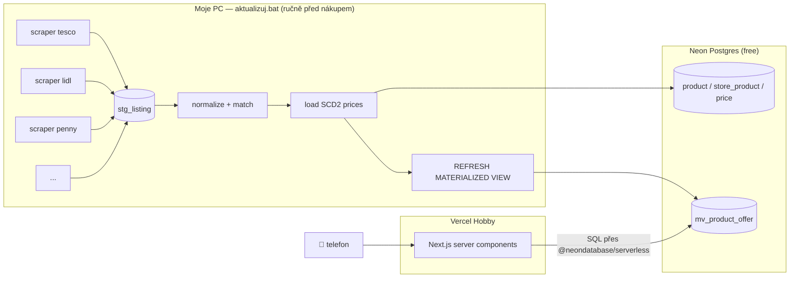

# Architektura

## Přehled
Klasická dávková ETL architektura (stejný princip jako DWH): **extract** (scrapery per obchod) → **staging** (surové položky) → **transform** (normalizace, párování) → **load** (SCD2 ceny) → **serving** (materializovaný pohled pro web).

## Komponenty
| Komponenta | Technologie | Kde běží | Zodpovědnost |
|---|---|---|---|
| Scrapery | Python 3.12, httpx, selectolax, Playwright (jen když nutné) | PC (ručně) | Stáhnout položky jednoho obchodu → `stg_listing` |
| Matcher | Python, rapidfuzz, pg_trgm | PC (ručně) | `store_product` → `product` |
| Loader | Python + SQL | PC (ručně) | SCD2 zápis cen, `scrape_run` log |
| DB | Postgres (Neon) | Neon Free | Data + pohledy |
| Web | Next.js (App Router) + Tailwind, Drizzle ORM | Vercel Hobby | Čtení, žádný zápis |

## Klíčové principy
- **Web je read-only.** Žádné API pro zápis, žádné tajné klíče s právem zápisu ve Vercelu (použít DB roli `web_ro` jen se SELECT).
- **Izolace zdrojů:** každý scraper je samostatný job v matici; selhání jednoho neblokuje ostatní (`fail-fast: false`).
- **Idempotence:** opakované spuštění téhož dne nesmí vytvořit duplicitní ceny (SCD2 zapisuje jen změnu).
- **Staging je pravda o tom, co zdroj vrátil** — surová data (`raw jsonb`) se drží 14 dní kvůli ladění parserů.
- **ISR/cache:** web cachuje stránky (revalidate 1 h); po aktualizaci skript zavolá on-demand revalidaci, takže nová data jsou vidět hned.

Rozhodnutí: [[ADR/ADR-001 Databáze]] · [[ADR/ADR-002 Orchestrace]] · [[ADR/ADR-003 Jazyk scraperu]] · [[ADR/ADR-004 Obrázky produktů]] · [[ADR/ADR-005 Ruční aktualizace na PC]]
