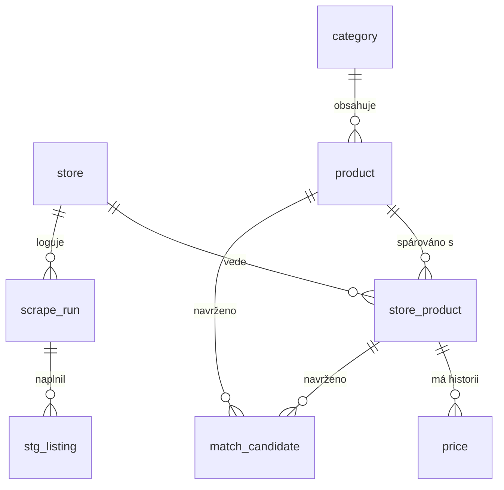

# Datový model

## Pojmy
- **product** — kanonický produkt napříč obchody = konkrétní varianta (značka + název + objem). *Finlandia Vodka 0,7 l* a *Finlandia Vodka 1 l* jsou dva produkty.
- **store_product** — položka tak, jak ji vede konkrétní obchod (jeho ID/URL, jeho název). Může být zatím nespárovaná (`product_id IS NULL`).
- **price** — cena položky v čase, **SCD2** (`valid_from`/`valid_to`), řádek vzniká jen při změně.
- **typ ceny:** `regular` (běžná), `promo` (akční, pro všechny), `loyalty` (jen s kartou/appkou).
- **zdroj ceny** (`price_source`): `catalog` (katalog e-shopu, Tesco), `leaflet` (akční cena z letáku/nabídky), `leaflet_regular` (běžná cena odvozená z „cena před slevou“ v letáku), `manual` (zadal jsem ručně z regálu).
- **promo platnost** (`promo_from`/`promo_to`) = obchodní platnost akce z letáku; **SCD2 platnost** (`valid_from`/`valid_to`) = kdy jsme cenu v datech viděli. Jsou to dvě různé věci.

## ER


## DDL (Postgres) — `db/migrations/001_init.sql`
```sql
create extension if not exists pg_trgm;
create extension if not exists unaccent;

-- unaccent není IMMUTABLE → wrapper kvůli indexům a generovaným sloupcům
create or replace function f_norm(t text) returns text
language sql immutable parallel safe as
$$ select lower(public.unaccent('public.unaccent', coalesce(t, ''))) $$;

create table store (
  id            smallserial primary key,
  code          text not null unique,          -- 'tesco','billa','albert','lidl','kaufland','penny','makro'
  name          text not null,
  website       text not null,
  logo_url      text,
  loyalty_name  text,                          -- 'Clubcard','Můj Albert','BILLA Klub','Lidl Plus','Kaufland Card'
  is_active     boolean not null default true
);

create table category (
  id         smallserial primary key,
  slug       text not null unique,             -- 'rum','vodka',...
  name       text not null,
  sort_order smallint not null default 100
);

create table product (
  id          bigserial primary key,
  category_id smallint not null references category(id),
  brand       text not null,
  name        text not null,                   -- bez objemu, např. 'Vodka'
  volume_ml   integer not null check (volume_ml > 0),
  abv         numeric(4,1),                    -- % alkoholu
  ean         text,
  image_url   text,
  slug        text not null unique,            -- 'finlandia-vodka-700ml'
  search_text text generated always as (f_norm(brand || ' ' || name)) stored,
  created_at  timestamptz not null default now(),
  unique (brand, name, volume_ml)
);
create index ix_product_search on product using gin (search_text gin_trgm_ops);
create index ix_product_category on product (category_id);

create table store_product (
  id            bigserial primary key,
  store_id      smallint not null references store(id),
  store_sku     text not null,                 -- ID ve zdroji; u letáků hash(normalizovaný název + objem)
  product_id    bigint references product(id), -- NULL = nespárováno
  raw_name      text not null,
  brand_guess   text,
  volume_ml     integer,
  abv           numeric(4,1),
  ean           text,
  url           text,
  image_url     text,
  source_kind   text not null check (source_kind in ('catalog','leaflet')),
  first_seen_at timestamptz not null default now(),
  last_seen_at  timestamptz not null default now(),
  unique (store_id, store_sku)
);
create index ix_sp_product on store_product (product_id);
create index ix_sp_unmatched on store_product (store_id) where product_id is null;

create table price (
  id               bigserial primary key,
  store_product_id bigint not null references store_product(id),
  price_type       text not null check (price_type in ('regular','promo','loyalty')),
  price_czk        numeric(10,2) not null check (price_czk > 0),
  regular_czk      numeric(10,2),              -- cena „před slevou“, pokud ji zdroj uvádí
  promo_from       date,
  promo_to         date,
  valid_from       timestamptz not null default now(),
  valid_to         timestamptz not null default 'infinity',
  price_source     text not null check (price_source in ('catalog','leaflet','leaflet_regular','manual')),
  observed_at      timestamptz not null default now(), -- kdy jsme cenu naposledy viděli/potvrdili
  scrape_run_id    bigint
);
-- max. jedna aktuální cena daného typu na položku
create unique index ux_price_current on price (store_product_id, price_type) where valid_to = 'infinity';

create table scrape_run (
  id            bigserial primary key,
  store_id      smallint not null references store(id),
  started_at    timestamptz not null default now(),
  finished_at   timestamptz,
  status        text not null default 'running' check (status in ('running','ok','partial','failed')),
  items_found   integer,
  items_changed integer,
  host          text,                          -- název PC, kde aktualizace běžela
  error         text
);

create table stg_listing (                     -- surová data, retence 14 dní
  id            bigserial primary key,
  scrape_run_id bigint not null references scrape_run(id),
  store_sku     text not null,
  payload       jsonb not null,                -- validovaný ScrapedItem (viz Scraper pipeline)
  raw           jsonb,                         -- co přesně vrátil zdroj (pro ladění)
  loaded_at     timestamptz not null default now()
);

create table match_candidate (
  store_product_id bigint not null references store_product(id),
  product_id       bigint not null references product(id),
  score            numeric(5,2) not null,      -- 0–100
  method           text not null,              -- 'ean','exact_norm','fuzzy'
  status           text not null default 'pending' check (status in ('pending','accepted','rejected')),
  created_at       timestamptz not null default now(),
  primary key (store_product_id, product_id)
);
```

## Odkud se vezme běžná cena u obchodů bez katalogu (Lidl, Penny, Albert, Kaufland)
Cíl: pro každý obchod mít **výchozí (běžnou) cenu**, kterou po dobu akce přebije akční cena.
1. **Z letáku:** akční položka obvykle uvádí „cena před slevou“ (`regular_czk`). Loader z ní vytvoří/aktualizuje cenu `price_type='regular', price_source='leaflet_regular'`. Po skončení akce tak v appce zůstane běžná cena.
2. **Ručně:** `aktualizuj.bat add-price` (CLI: obchod, produkt hledáním, cena) → `price_source='manual'`. Pro produkty, které kupuju často a nebývají v akci.
3. **Z katalogu** (Tesco, příp. Billa): `price_source='catalog'`.

⚠️ Omezení: běžnou cenu z letáku známe jen u produktů, které **někdy byly v akci**. Běžná cena se taky mění (zdražení) → u `leaflet_regular`/`manual` starších než 60 dní web zobrazí „běžná cena k 12. 9. — může být neaktuální“.

Priorita, když je běžných cen víc: `catalog` > nejnovější z (`manual`, `leaflet_regular`) podle `observed_at`.

## SCD2 zápis ceny (loader, v jedné transakci per scrape_run)
1. Pro každou položku z dnešního běhu a každý `price_type`:
   - aktuální řádek neexistuje → `INSERT`.
   - existuje a liší se (`price_czk`, `regular_czk`, `promo_from`, `promo_to`) → `UPDATE ... SET valid_to = now()` + `INSERT` nového.
   - shodný → jen `observed_at = now()` a `store_product.last_seen_at = now()`.
2. **Ukončení cen podle zdroje:**
   - `leaflet` (akce/loyalty): když dnes ve zdroji nebyla **a** zdroj doběhl `ok` → uzavřít. Při `partial`/`failed` nic neuzavírat. Akce se navíc filtruje podle `promo_to`, takže prošlá akce zmizí i bez nového běhu.
   - `catalog` (Tesco): položka chybí v `ok` běhu → uzavřít (stažení ze sortimentu).
   - `leaflet_regular` a `manual`: **nikdy neuzavírat chyběním** — jen přepsat novější hodnotou.
3. Leták zveřejněný dopředu (`promo_from > today`) se uloží, ale pohled ho ukáže až od `promo_from`.

## Serving vrstva — `db/migrations/002_views.sql`
Materializuje se jen „aktuální ceny“ (mění se pouze aktualizací). Datumové podmínky (platnost akcí k **dnešku**) jsou v obyčejných view, aby fungovaly správně i týden po poslední aktualizaci.

```sql
-- 1) aktuální ceny položek (refresh po každé aktualizaci)
create materialized view mv_current_price as
select sp.product_id, sp.store_id, sp.id as store_product_id, sp.url, sp.last_seen_at,
       p.price_type, p.price_source, p.price_czk, p.regular_czk,
       p.promo_from, p.promo_to, p.observed_at
from store_product sp
join price p on p.store_product_id = sp.id and p.valid_to = 'infinity'
where sp.product_id is not null;

create unique index ux_mv_current_price on mv_current_price (store_product_id, price_type);
create index ix_mv_current_price_product on mv_current_price (product_id);

-- 2) dnes platná nabídka: jedna (nejnižší) cena na produkt × obchod
create view v_store_offer_today as
select *
from (
  select c.*,
         row_number() over (partition by c.product_id, c.store_id
                            order by c.price_czk,
                                     case c.price_type when 'promo' then 1 when 'regular' then 2 else 3 end) as rn
  from mv_current_price c
  where (c.price_type = 'regular' or current_date between coalesce(c.promo_from, current_date)
                                                  and coalesce(c.promo_to, current_date))
) x
where rn = 1;

-- 3) karta pro úvodní mřížku (nejnižší cena napříč obchody)
create view v_product_card as
select pr.id, pr.slug, pr.brand, pr.name, pr.volume_ml, pr.image_url, pr.search_text,
       c.slug as category_slug,
       best.price_czk  as best_price,
       best.price_type as best_price_type,      -- 'loyalty' → UI zobrazí barevně + ⓘ
       best.regular_czk,
       best.promo_to,
       s.code          as best_store,
       s.loyalty_name  as best_loyalty_name,
       round(best.price_czk / pr.volume_ml * 1000, 2) as price_per_l,
       cnt.store_count
from product pr
join category c on c.id = pr.category_id
join lateral (select o.* from v_store_offer_today o
              where o.product_id = pr.id
              order by o.price_czk limit 1) best on true
join store s on s.id = best.store_id
join lateral (select count(*) as store_count
              from v_store_offer_today o where o.product_id = pr.id) cnt on true;

-- 4) stáří dat pro banner ve webu
create view v_data_freshness as
select s.code, s.name, max(r.finished_at) filter (where r.status in ('ok','partial')) as last_ok_at
from store s left join scrape_run r on r.store_id = s.id
where s.is_active
group by s.code, s.name;
```
Refresh po aktualizaci: `refresh materialized view concurrently mv_current_price;`
Nejnižší cena **zahrnuje i věrnostní ceny** (rozhodnuto 21. 11.) — UI je jen vizuálně odliší.
Výkon: tisíce řádků, view nad MV stačí. Kdyby mřížka zpomalila, přidat trigram index na `product.search_text` (už existuje) a filtrovat přes `product`.

## Historie cen — `db/migrations/004_price_history.sql` (M6)
- `v_price_history` — každá SCD2 verze ceny spárované položky (product_id, store_id, typ, zdroj, cena, promo a SCD2 platnost).
- `v_daily_best_price` — nejnižší platná cena produktu po dnech za posledních 90 dní; stejná pravidla platnosti jako `v_store_offer_today` (běžná vždy, akce jen v promo okně). Dnešní hodnota = `v_product_card.best_price` (ověřeno nad všemi 43 produkty).
- `grant select … to web_ro` je součástí migrace. Web bez migrace funguje, jen graf nezobrazí.

## Role
```sql
create role web_ro login password '...';
grant select on mv_current_price, v_store_offer_today, v_product_card, v_data_freshness, store, category, product to web_ro;
```
